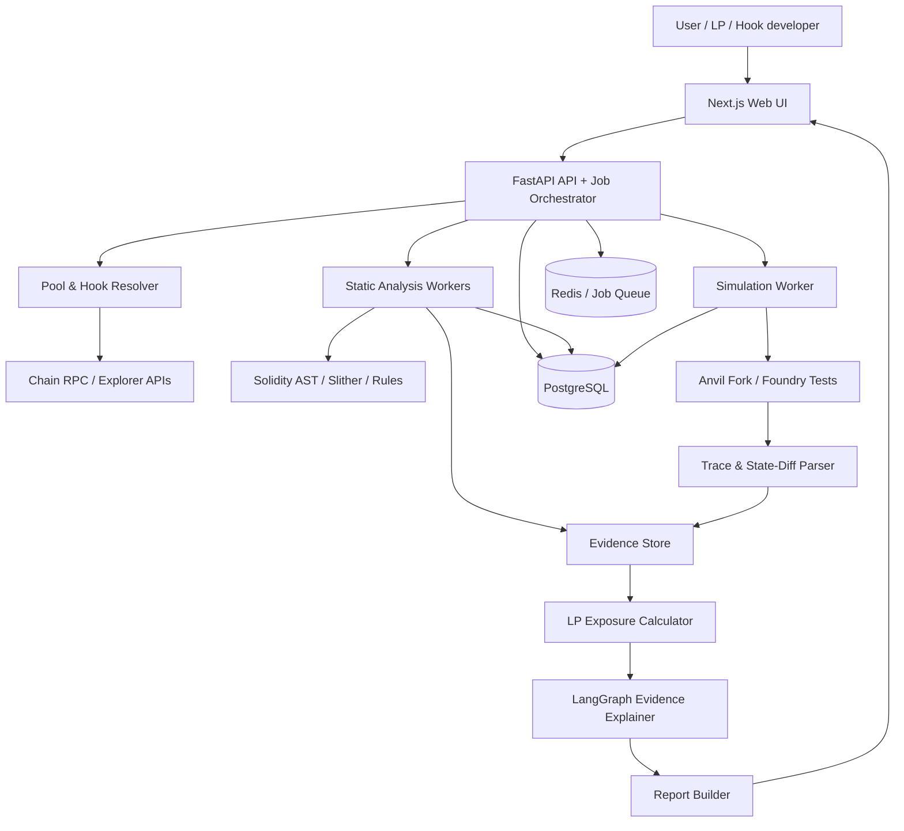

# HookLens — Uniswap v4 LP Intelligence & Adversarial Testing

**Tagline:** Test the hook. Understand your liquidity.  
**Category:** Open-source Uniswap v4 developer / LP risk tooling  
**Status:** Proposed product specification (not an audit or safety certification)

---

## 1. Executive summary

HookLens is an evidence-first testing platform for Uniswap v4 hooks. It combines hook discovery and deterministic code analysis with fork-based adversarial simulation and LP-position impact reporting. It helps liquidity providers, hook developers, integrators, and researchers answer a practical question:

> **What can this hook do to my liquidity position—and can I reproduce that behaviour before I deposit?**

HookLens is complementary to Uniswap Hook Warnings. Warnings identify code properties that may affect swaps, liquidity operations, or donations. HookLens focuses on executing defined scenarios, comparing expected and observed outcomes, and connecting those outcomes to a modeled LP position. It does not claim to prove a hook safe.

## 2. Problem statement

### 2.1 Context

Uniswap v4 uses a singleton `PoolManager` and allows a pool to attach one hook contract. Hook callbacks can run around initialization, swaps, liquidity modification, and donations. Hook address bits encode callback permissions. This extensibility supports dynamic fees, custom accounting, oracle integrations, and other pool behaviours—but also introduces additional code paths and dependencies.

### 2.2 The user problem

LPs commonly face a gap between **knowing a hook has a property** and **understanding what happens to their own position when that property is exercised**. A generic warning or source-code review may not answer:

- Does a removal transaction succeed when an external dependency is unavailable?
- How does a fee-setting path change execution under specific state and transaction ordering?
- Does a callback revert, return an unexpected delta, or violate an accounting invariant in a tested sequence?
- What is the modeled difference between baseline and adversarial outcomes for a chosen position and range?
- Can another developer reproduce the result from a test and trace rather than trusting a risk label?

### 2.3 Why this matters

Hooks execute in pool lifecycle paths and may depend on external contracts, privileged configuration, custom math, or stateful logic. A failure can affect swaps, liquidity operations, or accounting. A false positive is also costly: a warning should not automatically be presented as an exploit or proof of loss.

### 2.4 Existing tools and honest differentiation

| Existing resource | What it does | HookLens relationship |
|---|---|---|
| Uniswap Hook Warnings | Code-derived warnings about hook properties affecting swaps, adding/removing liquidity, and donations | Input/context; not a replacement |
| Uniswap Hooklist | Registry metadata, permission flags, and hook properties | Discovery/data source |
| Uniswap v4 Security Framework | Self-directed risk methodology, checklist, risk dimensions, and security recommendations | Methodology reference |
| HookScope research | Lifecycle-aware runtime security evaluation and simulation-based threat detection | Adjacent research; runtime simulation alone is not novel |
| Foundry/Anvil | Contract testing, fork execution, traces, fuzzing/invariants | Execution foundation, not a competitor product |

**Positioning:** Hook Warnings can surface properties; HookLens attempts to test selected behaviours and provide reproducible, LP-oriented evidence. Avoid claims such as “first hook scanner,” “fully secure,” “audited,” or “guaranteed protection.”

## 3. Product goals and non-goals

### Goals

1. Resolve a v4 pool/hook and identify its chain, code, permissions, and provenance.
2. Perform deterministic, explainable static checks.
3. Run user-selectable fork scenarios with reproducible state and inputs.
4. Check selected invariants and compare baseline vs scenario results.
5. Model LP position metrics with clear assumptions and units.
6. Produce a machine-readable and human-readable evidence report.
7. Keep AI explanations grounded in analyzer outputs, source references, and traces.

### Non-goals

- No guarantee that a hook is safe or unsafe.
- No autonomous exploit execution against mainnet or third-party funds.
- No investment advice, yield promise, or transaction recommendation.
- No replacement for a professional audit, formal verification, or monitoring.
- No fabricated findings when source is unverified or simulation coverage is incomplete.
- No automatic on-chain blocking or custody of user funds in the MVP.

## 4. Target users and workflows

### LP / liquidity manager
1. Paste pool or hook address and select chain.
2. Select or define a position (capital, token pair, tick range, assumptions).
3. Review permissions, source status, and static observations.
4. Run scenarios (e.g., oracle failure, fee bounds, withdrawal path).
5. Compare baseline and scenario results; inspect trace and limitations.
6. Export/share evidence report.

### Hook developer
1. Submit deployed hook address or local build artifact.
2. Run permission consistency, static analysis, scenario tests, and invariants.
3. Inspect reproducible failures and suggested test cases.
4. Fix code and rerun regression suite.
5. Publish a versioned test report with code hash and block provenance.

### Integrator / researcher
- Batch review selected hooks, compare risk dimensions, inspect source/trace evidence, and export findings for due diligence.

## 5. Product features

### F1 — Hook & Pool Resolver
- Input: chain + pool ID, PoolKey, or hook address.
- Resolve PoolManager, currencies, fee, tick spacing, hook address, and relevant pool metadata.
- Fetch runtime bytecode and code hash at a pinned block.
- Retrieve verified source/ABI where supported; identify proxy/implementation relationships where detectable.
- Record provenance: chain ID, block number/hash, RPC source, explorer/source status, compiler metadata.
- Mark source states: `verified`, `partial`, `unverified`, `bytecode-only`, `proxy-unresolved`.

### F2 — Permission & Static Analysis
- Decode permission bits using constants from the selected v4-core version.
- Compare address-encoded permissions with implemented callback interfaces and source/compiler metadata where possible.
- Inspect access control, fee bounds, external calls, oracle assumptions, upgradeability, pause/allowlist logic, custom accounting/deltas, callback reverts, and token assumptions.
- Use AST/call graph/data-flow analysis; do not rely on string matching alone.
- Run tools such as Slither and targeted Semgrep rules as supporting analyzers; preserve tool versions and rule IDs.
- Every finding includes evidence, rule, severity rationale, confidence, and limitations.

### F3 — Adversarial Simulation Lab
- Execute tests on a local fork or isolated deployment; never send test transactions to a live pool as part of analysis.
- Pin block number and fork RPC; snapshot/revert between cases.
- Use Foundry tests and Anvil; collect logs, revert data, call traces, gas, and state diffs.
- Support scenario templates and user-defined parameters.
- Keep each run deterministic where possible and record seeds/configuration.

### F4 — LP Position Impact Engine (core differentiator)
- Model a position by pool, token amounts/capital, tick range, liquidity, and relevant state.
- Calculate baseline and scenario outputs using Uniswap math libraries and exact pool state when available.
- Separate principal mark-to-market, fee income, token composition, price movement/divergence vs hold, and simulated hook effects.
- Report metrics only when calculation inputs are available; otherwise show “not calculated.”
- Clearly label hypothetical, scenario-dependent results; avoid calling a modeled outcome actual loss.

### F5 — Evidence Explorer
- Link findings to Solidity source line/function, bytecode/code hash, scenario inputs, test ID, trace, and state diff.
- Show expected vs observed result and reproduction instructions.
- Distinguish static inference from executed observation.

### F6 — Report Generator
- Generate HTML/Markdown/JSON report.
- Include scope, chain, block, code hashes, source provenance, analyzers and versions, scenario coverage, findings, evidence, LP assumptions, limitations, and reproducibility steps.
- Include a clear disclaimer: not an audit, investment advice, or safety guarantee.

### F7 — AI Evidence Explainer (supporting feature)
- LangGraph workflow receives only structured deterministic findings, source snippets, test traces, and metadata.
- AI can summarize, explain implications, and organize remediation ideas.
- AI cannot independently mark a contract vulnerable/safe or invent evidence.
- Output schema is validated; unsupported claims are rejected or marked unknown.

## 6. Threat / scenario catalogue

The first version should implement three reliable scenarios, then expand:

### S1 — Fee bounds and configuration
- Exercise normal swaps and permitted fee updates.
- Test configured minimum/maximum bounds, unexpected state changes, and unauthorized update attempts.
- Compare effective fee and swap outcome to expected bounds.
- Do not assume dynamic fees are inherently malicious.

### S2 — Liquidity removal under dependency failure
- Add/prepare an LP position in the test environment.
- Exercise normal removal.
- Simulate external oracle/dependency revert, stale response, zero value, or unavailable dependency if the hook actually relies on it.
- Capture removal success/revert, reason, callback path, and conditions.
- A revert is not automatically a vulnerability: establish whether it is intended, documented, and materially harmful.

### S3 — Accounting / delta invariants
- Exercise add/remove liquidity and swap sequences with varying amounts and ordering.
- Check settlement balances, delta signs/bounds, and no unexplained accounting drift.
- Use invariant/stateful fuzz tests where the harness supports it.

### Later scenarios
- Oracle manipulation and stale data.
- Admin/role/upgrade misuse (authorized and unauthorized actors).
- Transaction ordering / split swaps / same-block sequences.
- Pause/allowlist/blacklist edge cases.
- Non-standard token behavior (fee-on-transfer, rebasing, pausable), only where token support is explicitly modeled.

## 7. System architecture



### Recommended stack

| Layer | Technology | Responsibility |
|---|---|---|
| Frontend | Next.js, React, TypeScript | Scan UI, scenario configuration, evidence/report views |
| Web3 client | viem / wagmi | Address/chain handling and optional wallet connection |
| API | Python FastAPI | Auth, validation, scan orchestration, report endpoints |
| Jobs | Redis + Celery/RQ (choose one) | Long-running analysis and simulation jobs |
| Contract analysis | solc AST, Slither, Semgrep rules | Deterministic static observations |
| Execution | Foundry, Anvil, Solidity test harness | Fork simulation, fuzzing, invariants |
| LP math | Uniswap v4-core / v4-periphery math libraries | Position and pool calculations |
| AI | LangGraph + chosen LLM provider | Evidence-grounded explanation only |
| Persistence | PostgreSQL | Scan metadata, run configuration, findings, reports |
| Artifact storage | Local filesystem for MVP; object storage later | Source snapshots, traces, JSON artifacts |
| Deployment | Docker Compose | Reproducible local/hackathon environment |

## 8. Repository layout

```text
hooklens/
├── README.md
├── FEEDBACK.md
├── LICENSE
├── docker-compose.yml
├── .env.example
├── contracts/
│   ├── harness/
│   ├── actors/
│   └── test-hooks/
├── foundry.toml
├── test/
│   ├── scenarios/
│   ├── invariants/
│   └── unit/
├── backend/
│   ├── app/main.py
│   ├── app/api/{scans.py,simulations.py,reports.py}
│   ├── app/schemas/
│   ├── app/services/{resolver.py,scan_service.py,simulation_service.py}
│   ├── app/analyzers/{permissions.py,access_control.py,fees.py,oracle.py,withdrawal.py,accounting.py}
│   ├── app/simulation/{fork_manager.py,scenario_runner.py,trace_parser.py,state_diff.py}
│   ├── app/lp_exposure/{position.py,valuation.py,comparison.py}
│   ├── app/ai/{graph.py,prompts.py,schemas.py}
│   ├── app/reports/{builder.py,templates/}
│   └── tests/
├── frontend/
│   ├── app/{,scan/,pool/,lab/,position/,reports/}
│   ├── components/{scanner,findings,scenario,charts,evidence}/
│   └── lib/{api,web3,schemas}/
├── fixtures/{verified-hooks,scenario-inputs}/
└── docs/{architecture,methodology,threat-model,limitations}/
```

## 9. Core data model

### Scan
- `scan_id`, `chain_id`, `pool_id`, `hook_address`
- `block_number`, `block_hash`, `runtime_code_hash`
- `source_status`, `source_hash`, `compiler_version`
- `permission_flags`, `analyzer_versions`, `created_at`

### Finding
- `finding_id`, `scan_id`, `rule_id`, `category`, `severity`, `confidence`
- `title`, `summary`, `evidence_refs[]`, `source_locations[]`
- `affected_operations[]`, `impact_hypothesis`, `limitations[]`
- `status`: `observed`, `inferred`, `needs-review`, `not-reproduced`

### SimulationRun
- `run_id`, `scan_id`, `scenario_id`, `scenario_version`
- `fork_block`, `fork_block_hash`, `rpc_fingerprint`
- `parameters`, `actor_roles`, `seed`, `test_commit`
- `expected_outcome`, `observed_outcome`, `exit_status`
- `trace_artifact`, `state_diff_artifact`, `reproduction_command`

### PositionModel
- `position_id`, `pool_id`, `tick_lower`, `tick_upper`, `liquidity`
- `capital_assumptions`, `token_decimals`, `price_source`, `valuation_block`
- `baseline_metrics`, `scenario_metrics`, `calculation_version`

### Report
- `report_id`, `scan_id`, `run_ids[]`, `position_id?`
- `generated_at`, `report_version`, `content_hash`, `limitations`

## 10. API design (MVP)

| Method | Endpoint | Purpose |
|---|---|---|
| POST | `/v1/scans` | Start scan for chain + pool/hook |
| GET | `/v1/scans/{scan_id}` | Scan status and metadata |
| GET | `/v1/scans/{scan_id}/findings` | Deterministic findings |
| POST | `/v1/scans/{scan_id}/simulations` | Start scenario run |
| GET | `/v1/simulations/{run_id}` | Run status/outcome |
| GET | `/v1/simulations/{run_id}/trace` | Trace/state diff evidence |
| POST | `/v1/positions` | Create LP position model |
| POST | `/v1/positions/{position_id}/compare` | Compare baseline and selected scenario |
| POST | `/v1/reports` | Generate report |
| GET | `/v1/reports/{report_id}` | Retrieve report metadata/content |

API jobs should return a job ID quickly; simulation is asynchronous. Validate chain allowlists, address formats, RPC limits, payload size, and user-supplied scenario bounds.

## 11. Simulation implementation details

- Pin a fork to a specific block and record the block hash.
- Use Anvil snapshots to isolate test cases; never reuse mutated state unintentionally.
- Use dedicated test actors: `LPActor`, `TraderActor`, and `AdminActor`.
- Prefer tests that assert concrete properties, not only that a transaction reverted.
- Export transaction/call traces and relevant storage/balance deltas.
- For unknown hooks, build an adapter/harness carefully; arbitrary hook execution may require custom setup and compatible pool/token state.
- Do not promise universal fork compatibility: some scenarios need verified source, deployable test harnesses, or specific pool state.

Example Foundry command (adapt to the repo's config and target chain):

```bash
forge test --match-path 'test/scenarios/*' -vvv
anvil --fork-url "$RPC_URL" --fork-block-number "$BLOCK_NUMBER"
```

## 12. LP impact methodology

The LP engine must clearly separate:

1. **Principal mark-to-market:** modeled token inventory value at a selected price.
2. **Fee income:** only fees actually accrued or explicitly estimated under stated assumptions.
3. **Price divergence / impermanent-loss comparison:** compare position value to a clearly defined hold benchmark.
4. **Hook scenario effects:** only measured differences supported by scenario execution or explicit model assumptions.
5. **Liquidity availability:** operation success/revert under the tested conditions, not a universal guarantee.

Use Uniswap's math libraries and exact tick/liquidity state wherever possible. Account for token decimals, tick spacing, rounding, range activity, and price source. Avoid double-counting fees or treating simulated outcomes as real losses.

## 13. AI workflow and structured output

```text
Scan/Simulation artifacts
  → Evidence normalizer
  → Finding schema validation
  → LangGraph explanation node
  → Citation/evidence checker
  → JSON schema validation
  → Report renderer
```

AI output fields:
- `finding_id`
- `plain_language_explanation`
- `technical_mechanism`
- `lp_relevance`
- `evidence_refs[]`
- `reproduction_steps[]`
- `mitigation_ideas[]`
- `confidence_explanation`
- `limitations[]`

If evidence is absent, AI must return `unknown` or `insufficient evidence`. Keep deterministic analyzer outputs unchanged and separately stored.

## 14. Frontend screens

1. **Scan:** chain, pool/hook address, source verification, scan status.
2. **Hook profile:** permissions, callback coverage, code provenance, static observations.
3. **Scenario lab:** scenario selection, actor/parameter configuration, run progress.
4. **LP position:** amount, tick range, baseline vs scenario metrics and assumptions.
5. **Evidence explorer:** source lines, trace, revert data, state diff, reproduction command.
6. **Report:** executive summary, findings, scenario coverage, limitations, export/share.

Use neutral statuses such as `Observed`, `Potential`, `Not tested`, and `Inconclusive`. Avoid a single green “safe” badge.

## 15. MVP scope and build sequence

### Phase 0 — Foundations
- Create public repo, license, `FEEDBACK.md`, threat model, architecture doc.
- Pin Uniswap v4-core/periphery versions and supported chains.
- Establish Foundry test fixture and reproducible fork workflow.

### Phase 1 — Resolver + permissions
- Resolve pool/hook metadata and bytecode hash.
- Decode permissions using pinned v4-core constants.
- Show source verification status and callback list.
- Add unit tests for permission decoding and malformed inputs.

### Phase 2 — Three deterministic scenarios
- Fee bounds/configuration.
- LP removal under dependency failure (only for hooks with that dependency).
- Accounting invariants / delta checks.
- Save traces, test commands, and state differences.

### Phase 3 — LP position comparison
- Define a narrow position model for a supported pool.
- Implement baseline calculations and scenario comparison.
- Show explicit assumptions and units.

### Phase 4 — Evidence report + AI
- Report builder and JSON schema.
- AI explanation grounded in findings and trace references.
- Evidence validation and hallucination checks.

### Phase 5 — Polish and feedback
- Demo fixtures, README walkthrough, reproducible command.
- Submit Uniswap Developer Feedback Form and link `FEEDBACK.md`.
- Document limitations and unsupported scenarios.

## 16. Hackathon demo storyline (3–5 minutes)

1. Open a known v4 pool/hook and show exact chain/block/code provenance.
2. Show hook permissions and one source-backed observation.
3. Select an LP position and a scenario (oracle/dependency failure where applicable).
4. Run fork test; show transaction failure/success and trace evidence.
5. Compare baseline vs scenario LP operation/metrics.
6. Open the report and reproduce the test from the command.
7. Explain that HookLens complements warnings and does not certify safety.

The demo should use a controlled test hook or a verified hook whose behavior is known. Do not manufacture a vulnerability in a real deployed contract.

## 17. Testing and quality gates

- Unit: permission decoding, address validation, source parsing, math, schema validation.
- Integration: resolver against pinned RPC/block, source explorer adapter, report generation.
- Scenario: deterministic test hooks and supported fork hooks.
- Invariants: settlement/delta properties appropriate to harness.
- Regression: every finding scenario becomes a reproducible test fixture.
- AI: evidence citation coverage, JSON validity, unsupported-claim rejection.
- Security: API rate limits, SSRF/RPC controls, process isolation, secret management, dependency pinning.

## 18. Risks, constraints, and mitigations

| Risk | Mitigation |
|---|---|
| Unverified or incomplete source | Mark bytecode-only; lower confidence; don't fabricate source lines |
| Proxy/implementation ambiguity | Resolve known proxy patterns; state unresolved cases explicitly |
| Fork state unavailable or RPC limits | Pin block; retry carefully; support local fixtures; report incomplete runs |
| Hook requires custom setup | Scenario adapters and test harness; clearly limit coverage |
| False positives | Evidence-backed rules, severity rationale, human review, reproducible test |
| False sense of safety | Never show “safe”; show tested scope and uncovered paths |
| AI hallucination | Deterministic findings first; citations/schema checks; AI cannot create evidence |
| LP math misleading | Use protocol math; disclose assumptions; distinguish principal/fees/IL/scenario deltas |
| Excessive hackathon scope | Prioritize one pool, one position model, three scenarios, one report |

## 19. Success metrics

- Scan produces provenance and permission profile for supported hooks.
- At least three scenarios execute reproducibly in a documented environment.
- Every reported runtime observation links to a trace/test.
- LP comparison reconciles to the selected math library within documented rounding tolerance.
- Report can be independently reproduced by a reviewer.
- No finding is presented without evidence or a clear inference label.
- Developer feedback is collected and documented.

## 20. Public repository and submission checklist

- [ ] Public GitHub repository and open-source license.
- [ ] `README.md` explains problem, solution, architecture, quickstart, demo, limitations.
- [ ] `FEEDBACK.md` records product feedback and submission link.
- [ ] Uniswap Developer Feedback Form completed; include repository and `FEEDBACK.md` links.
- [ ] Relevant contract/test paths and line references in README.
- [ ] Reproducible Foundry commands and `.env.example` (no secrets).
- [ ] Pinned dependency versions and supported chain/block notes.
- [ ] Screenshots/demo recording and sample report.
- [ ] Explicit non-audit / non-investment-advice disclaimer.

## 21. Recommended initial implementation choices

- **Scope:** Uniswap v4 only; one supported chain for MVP; one controlled hook fixture plus one real hook if practical.
- **Core value:** withdrawal-path and accounting scenario evidence tied to LP position context.
- **Do first:** resolver → permission decoder → Foundry scenario → trace evidence → LP comparison → report.
- **Do later:** broad chain coverage, automated batch scans, advanced symbolic execution, monitoring, public hook leaderboard.
- **Avoid:** risk score as the main feature, generic AI audit claims, dozens of shallow rules, or unverified “loss prediction.”

## 22. References (official and research)

1. Uniswap v4 Security Framework: https://developers.uniswap.org/docs/protocols/v4/security
2. Uniswap v4 Hooks concepts: https://developers.uniswap.org/docs/protocols/v4/concepts/hooks
3. Understanding Uniswap v4 Hooks: https://developers.uniswap.org/docs/get-started/concepts/hooks
4. Uniswap Hook Warnings: https://support.uniswap.org/hc/en-us/articles/32402040565133-What-are-hook-warnings
5. Uniswap v4 Hooklist: https://github.com/Uniswap/hooklist
6. Uniswap v4-core: https://github.com/Uniswap/v4-core
7. Uniswap v4 public hooks: https://github.com/Uniswap/v4-hooks-public
8. Uniswap v4 template: https://github.com/uniswapfoundation/v4-template
9. HookScope paper (Computer Networks, February 2026): https://www.sciencedirect.com/science/article/pii/S1389128625008667
10. Foundry documentation: https://book.getfoundry.sh/

## 23. Final product definition

**HookLens is an open-source Uniswap v4 LP intelligence and adversarial testing platform that turns hook properties into reproducible execution evidence and position-level scenario analysis.** It complements existing hook warnings by focusing on what happens when a hook is exercised—not merely what its code appears to permit.

*Not an audit. Not a safety guarantee. A reproducible testing and evidence tool.*
